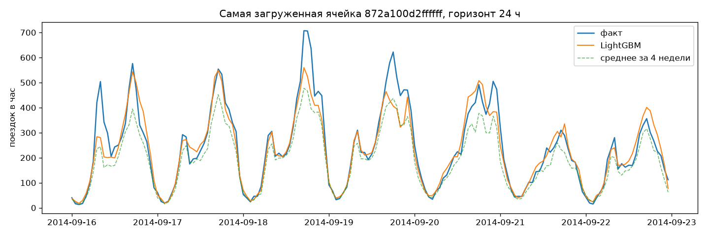
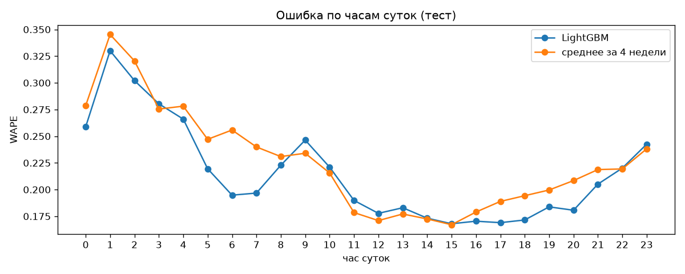

# Прогноз спроса на такси по районам города

Почасовой прогноз числа заказов такси в каждом районе города на сутки вперёд. Такой прогноз нужен, чтобы заранее распределять машины и водителей по районам (и вообще планировать нагрузку на транспорт).

Данные: 4,5 млн реальных поездок Uber в Нью-Йорке за апрель–сентябрь 2014. Открытого датасета такого размера по Москве с координатами каждой поездки я не нашёл. Нью-Йоркские данные опубликованы городской комиссией NYC TLC по запросу FOIL, и задача на них ставится так же, как ставилась бы для Москвы.

## Результат

Тестовый период: 16–30 сентября 2014 (последние две недели, в обучение не попадали). Метрика: WAPE = сумма |ошибок| / сумма факта.

**Прогноз на сутки вперёд (horizon = 24 ч)**, основной сценарий:

| Модель | WAPE | MAE, поездок/час | RMSE |
|---|---|---|---|
| тот же час вчера | 0.351 | 12.80 | 33.0 |
| тот же час неделю назад | 0.231 | 8.43 | 21.3 |
| среднее того же часа за 4 недели | 0.210 | 7.67 | 19.4 |
| **LightGBM (poisson)** | **0.199** | **7.25** | **17.4** |

**Прогноз на час вперёд (horizon = 1 ч)**:

| Модель | WAPE | MAE | RMSE |
|---|---|---|---|
| значение прошлого часа | 0.267 | 9.74 | 20.5 |
| среднее того же часа за 4 недели | 0.210 | 7.67 | 19.4 |
| **LightGBM (poisson)** | **0.157** | **5.71** | **11.9** |

На горизонте в сутки модель обгоняет сильный сезонный бейзлайн всего на ~5% по WAPE, зато RMSE падает на 10%: модель реже сильно промахивается на пиках. На горизонте в час выигрыш уже 25%, потому что модели доступна свежая динамика. Почему на сутках выигрыш скромный, разобрано ниже.



## Как устроено

```
сырые поездки (lat, lon, время)
  -> фильтр выбросов по координатам (0.5% точек за пределами NYC, вплоть до 150 км)
  -> H3-гексагоны res 7 (~5 км²), оставляю 37 ячеек = 95% всех поездок
  -> агрегация по часам + заполнение пустых часов нулями
  -> признаки (лаги, скользящие средние, календарь)
  -> LightGBM, одна глобальная модель на все ячейки
```

**Почему H3, а не административные районы.** У гексагонов одинаковая площадь и одинаковые соседи, поэтому ячейки можно сравнивать между собой. Кроме того, для разбиения не нужен shapefile границ районов, а для Москвы тот же код заработает без изменений.

**Почему одна модель на все ячейки.** Отдельная модель для 37 ячеек — это 37 моделей, и у маленьких ячеек мало данных. Глобальная модель с ячейкой как категориальным признаком учится на общих закономерностях (суточный профиль у всех похожий) и при этом умеет различать ячейки.

**Признаки**
- лаги `t-24, t-25, t-26, t-48, t-168, t-336`: все не меньше горизонта, иначе это утечка
- среднее того же часа за последние 4 недели
- скользящие среднее/std за 24 ч и 168 ч, сдвинутые на горизонт
- час, день недели, выходной, праздник, `is_party_night` (ночи пт→сб и сб→вс)
- id ячейки (categorical)

**Валидация** строго по времени:

```
| прогрев лагов | train: 29.04 – 31.08 | valid: 1–15.09 | test: 16–30.09 |
```

На valid выбирал вариант модели и число деревьев (early stopping), потом переобучал на train+valid и один раз проверял на test.

## Что пробовал и что не сработало

Valid, h=24 (valid сложнее теста: скачок спроса в начале сентября и Labor Day):

| Вариант | WAPE | bias |
|---|---|---|
| среднее за 4 недели (бейзлайн) | 0.302 | −21% |
| LightGBM, L2, таргет как есть | 0.248 | −14% |
| LightGBM, L2, таргет / недельный уровень | 0.243 | −10% |
| **LightGBM, Poisson, таргет как есть** | **0.243** | −15% |
| + городские агрегаты (суммарный спрос по всем ячейкам) | 0.263 | хуже, убрал |

- **Тренд.** Спрос за полгода вырос почти в 2 раза (18.7 тыс. поездок в день в апреле, 34.1 тыс. в сентябре), а в начале сентября был резкий скачок относительно августа. Деревья не экстраполируют за пределы значений из train, поэтому на valid все модели занижают прогноз: смещение (bias) у бейзлайна −21%, у LightGBM с L2 −14%. Нормировка таргета на уровень последней недели уменьшила смещение до −10% и RMSE на 6%. Poisson-лосс дал лучший WAPE, но смещение почти не убрал (−15%). По основной метрике выбрал Poisson. После переобучения на train+valid модель видит уровень начала сентября, и на тесте смещение уже +1.9%. Честно говоря, проблема решена не до конца: следующий шаг — совместить Poisson с нормированным таргетом.
- **Городские агрегаты** (суммарный спрос, тренд по городу) на valid ухудшили результат. Скорее всего, модель переобучилась на общий уровень, а в valid попал Labor Day. Убрал.
- **Лаг `t-1` и горизонт.** С лагом `t-1` модель выдаёт WAPE 0.157, и это легко принять за прогноз на сутки. На самом деле это прогноз на час: при прогнозе на завтра значение прошлого часа ещё неизвестно. Поэтому горизонт стал параметром, все лаги строятся от него, а в `tests/` есть проверка, что признаки не заглядывают в будущее.

## Ограничения

- **Нет погоды.** В Нью-Йорке дождь заметно поднимает спрос на такси, и на графике выше видны пики (16 и 18 сентября), которые модель не ловит. Это главный кандидат на улучшение, но архив NOAA из моего окружения был недоступен.
- Хуже всего прогнозируются ночные часы (1–3 ночи, WAPE ~0.3) и маленькие ячейки на окраинах: там мало поездок, и относительная ошибка большая.
- Данные 2014 года, и это только Uber, а не весь рынок такси.



## Запуск

```bash
pip install -r requirements.txt
python scripts/download_data.py      # ~210 МБ с GitHub
python -m src.prepare                # -> data/processed/demand.parquet
python -m src.train --horizon 24     # метрики -> reports/metrics_h24.json
python -m src.evaluate --horizon 24  # графики -> reports/figures/
pytest tests
```

На ноутбуке всё целиком занимает пару минут.

## Структура

```
├── notebooks/01_eda.ipynb   разведочный анализ: тренд, сезонность, карта спроса
├── scripts/
│   ├── download_data.py
│   └── experiment_city_features.py   эксперимент с городскими признаками (не зашёл)
├── src/
│   ├── config.py            пути, границы выборок, параметры H3
│   ├── prepare.py           сырые поездки -> почасовой спрос по ячейкам
│   ├── features.py          лаги, скользящие окна, календарь
│   ├── metrics.py           WAPE, MAE, RMSE, bias
│   ├── train.py             бейзлайны + LightGBM, сохраняет модель и метрики
│   └── evaluate.py          графики ошибок
├── reports/                 метрики (json) и графики
└── tests/                   проверка, что признаки не заглядывают в будущее
```

## Что дальше

- добавить погоду (осадки, температура) и события (концерты, матчи)
- квантильные прогнозы: для планирования важнее знать «с вероятностью 90% будет не больше N», чем среднее
- учитывать соседние ячейки (спрос в соседних гексагонах как признак)
- перенести на московские данные, если получу доступ
